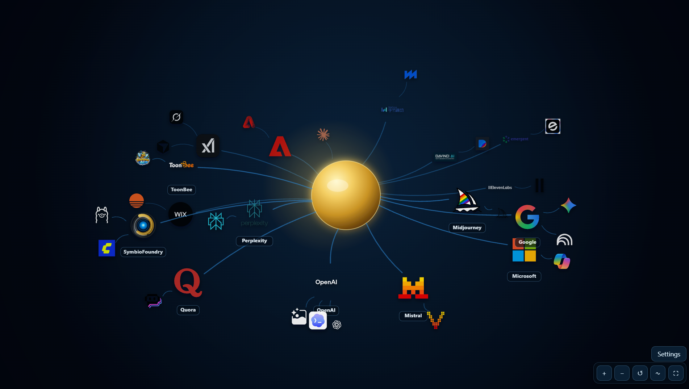
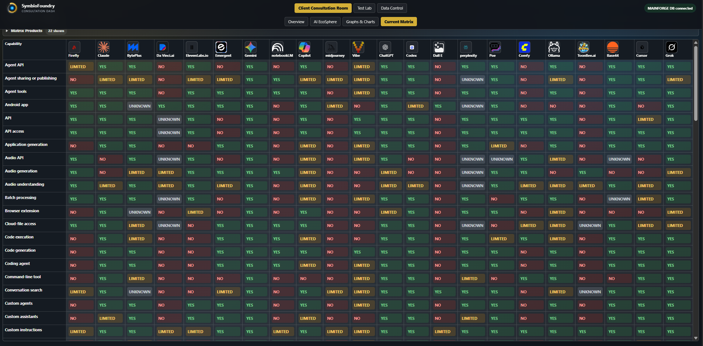
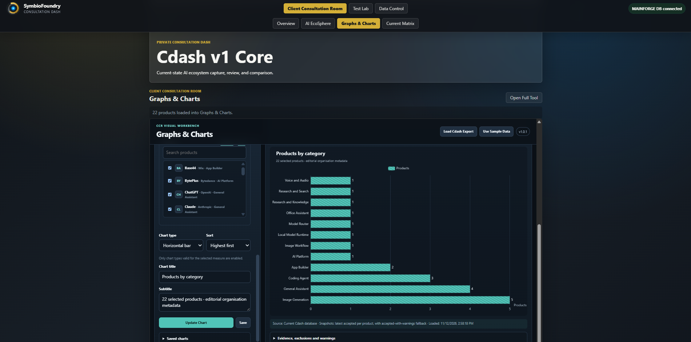
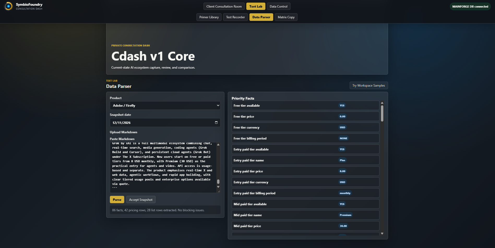

# Consultation Dashboard — engineering portfolio v0.2

**SymbioFoundry | AI evaluation and client consultation decision-support | Work in progress**

This project standardizes AI-product research into reviewed structured records, then aims to connect those records to client needs questionnaires and a recommendation workflow. The platform is an active systems-engineering project; the final consultation and matching pipeline is not complete.

## What's inside

- `source/` — dashboard frontend, Python/FastAPI backend source, AI EcoSphere visualisation and Graphs & Charts workbench
- `source/client_tools/ccr_visual_workbench/` — standalone visualization engine and Apache ECharts dependency (license retained)
- `source/client_tools/ai_ecosphere_v1_0_1/` — interactive product/provider visualization and a sample data adapter
- `docs/` — architecture, status, evidence, package-specific changes and publication boundary

## Run a safe local preview

Requires Python 3 or Node.js. The static preview does **not** connect to MAINFORGE or PostgreSQL. From the repository root:

```bash
cd source
python3 preview.py
# or: node local-server.js
```

Open `http://127.0.0.1:8765/`. The root application falls back to local browser storage when no API is present. **Do not enter real client data in a demonstration browser.**

From the dashboard, open **AI EcoSphere** to explore provider and product relationships. In **Graphs & Charts**, select **Use Sample Data** in the start dialog and build **Products by category**. The workbench sample contains eight fictional products.

## Real deployed architecture

The operational version uses a Python/FastAPI backend, PostgreSQL and a browser UI. This package includes `source/server.py` for source review. The production DB schema, database, credentials, user data and deployment configuration are excluded.

## Screenshots — working development deployment

These screenshots were captured on 12 November 2026 from the **running SymbioFoundry Consultation Dashboard**, connected to its private MAINFORGE database. They are evidence of the operational development deployment, **not** screenshots of the isolated source-review preview provided in this repository. The source-review preview uses local browser storage and synthetic sample data; production database contents, credentials, private configuration and client information are excluded.

### AI EcoSphere — provider/product relationship map



Interactive visual exploration of AI providers and products. The relationship map, navigation controls and layout are working application features.

### Current Matrix — structured capability comparison



Matrix of product research observations across capability categories. **Values reflect collected research snapshots and review status, not independent certification or guarantees of vendor functionality.** Vendor/product offerings change over time.

### Graphs & Charts — category distribution



A working visual workbench generating a chart from the deployed dashboard's current product registry. The chart organizes catalog metadata; category counts are not evidence of product quality or verified capabilities. The standalone preview can instead load synthetic demonstration data.

### Data Parser — Markdown snapshot extraction



A research snapshot parsed into structured fields. The displayed run reports **86 extracted facts, 42 pricing rows, 28 list rows and no blocking parse issues**. These are parser results, **not verification that the underlying vendor claims or prices are accurate**. Acceptance of a parsed snapshot is a separate review step.

> **Development scope:** Research ingestion, registry management, snapshots, comparison and selected visual tools are implemented. The integrated client-needs matching/recommendation workflow and takeaway package generation remain in development. See [Development Status](docs/DEVELOPMENT_STATUS.md).

## Current scope and status

Research primer and parsing, provider/product registry, accepted snapshots, comparison matrix, client and consultant registries, and selected visual tools have been implemented. Separate questionnaires have been built but are not included in this particular historical release. The integrated Client Consultation Room and recommendation engine are unfinished.

See [Architecture](docs/ARCHITECTURE.md), [Status](docs/DEVELOPMENT_STATUS.md), [Verification](docs/VERIFICATION.md), and [Publication Boundaries](docs/PUBLICATION_BOUNDARIES.md).

## Engineering work

Systems design, modular requirements analysis, integration, troubleshooting, test planning, deployment verification and AI-assisted software development. The source was built with AI assistance under developer direction and review.

**Portfolio source review.** This repository documents implemented engineering work and known limitations. Repository visibility remains private until a separate public-release approval and final verification. The original project retains its existing copyright. The bundled ECharts distribution has its own [third-party notices](source/client_tools/ccr_visual_workbench/THIRD_PARTY_NOTICES.md).
