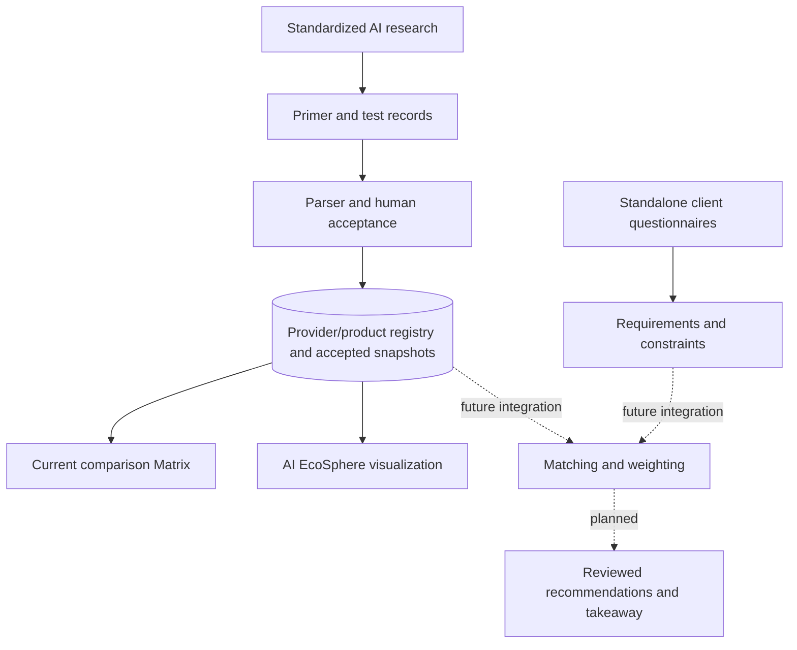

# Architecture

## Implementation

- Frontend: HTML, CSS, vanilla JavaScript
- Server-side architecture: Python/FastAPI and PostgreSQL using `psql` integration
- Visual workbench: JS with bundled Apache ECharts 6.1.0
- EcoSphere: standalone browser visualisation consuming normalized matrix data
- Local-preview fallback: browser storage, **not equivalent to the deployed PostgreSQL-backed workflow**

The architecture reflects a mixture of completed elements and planned integration. Dashed connections are not implemented in the inspected deployed core.
